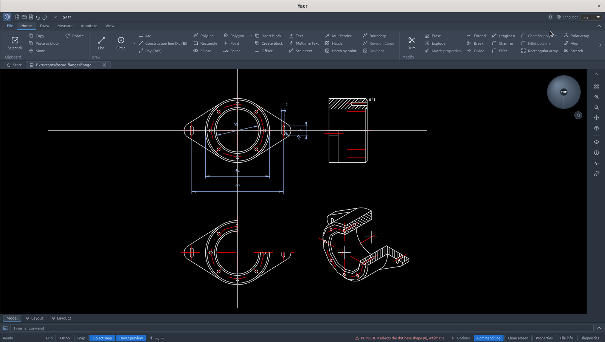
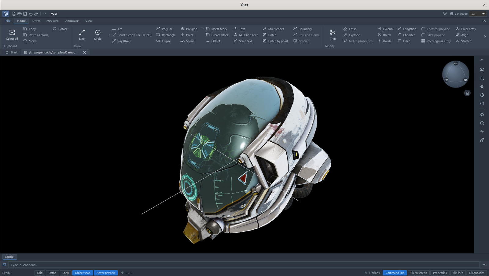
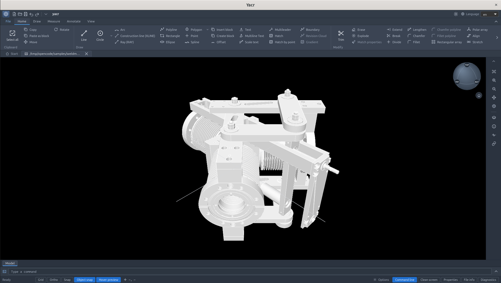
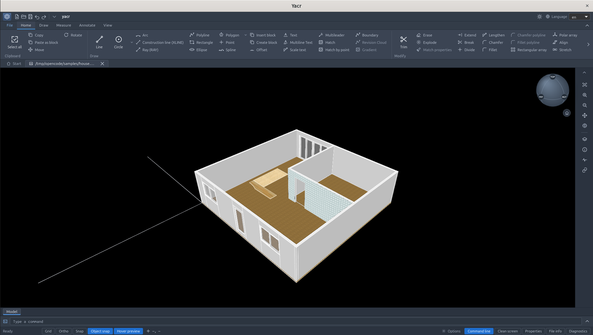
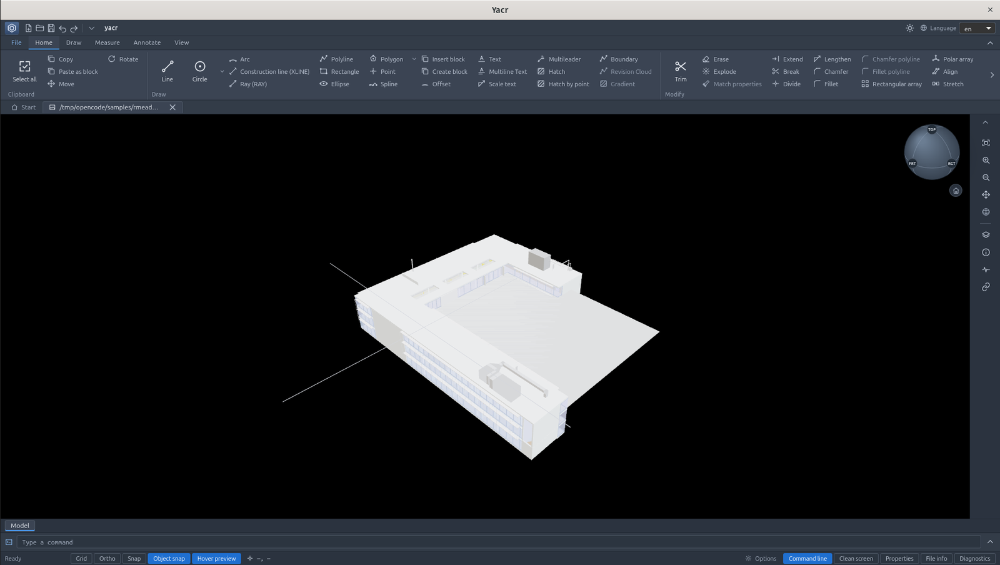

# yacr

[English](README.md) | [中文](README.zh-CN.md)

**Yet another CAD, written in Rust.** An open-source cross-platform CAD
application: a Rust core owns drawings, geometry, commands and wgpu rendering,
and one React interface runs on Linux, Windows, macOS, Android and the web.

> **PREVIEW** — builds are downloadable and runnable today, but yacr is not yet a
> production CAD system. Capabilities and evidence boundaries are kept in
> [`docs/compatibility.md`](docs/compatibility.md).

**Website** <https://yacr.pages.dev/> · **Web app** <https://yacr-examples.pages.dev/> ·
**Downloads** <https://github.com/zenglanmu/yacr/releases>



*Real run on Linux native Wayland (NVIDIA Quadro P620, Vulkan/wgpu), opening
`fixtures/dxf/qcad-flange/flange.dxf`.*

## What it does

- **Open the drawings you already have.** DWG, DXF (ASCII and binary) and Bentley
  DGN V7/V8 open as CAD data — layers, lines, arcs, ellipses, splines, text,
  shared cells — through one importer with progress and cancellation.
- **Bring in everything else.** OBJ, STL, PLY, OFF, STEP (AP203/214/242), glTF/GLB and IFC
  (2X3/4/4X3) open as display-and-pick meshes; Revit projects (`.rvt`/`.rte`) as a
  preview mesh with BIM metadata, SketchUp models (`.skp`) as a textured
  triangle mesh with real display edges (display, picking, and endpoint/midpoint
  measurement on the edges the file actually stores).
- **Choose the working style.** Four application domains — 2D drafting, BIM,
  concept modelling and mechanical design — each with its own chrome and theme.
  The domain is a document property derived from the imported file (DWG/DXF/DGN,
  IFC/RVT, SKP, STEP), switchable with `DOMAIN`; all four run on the same React
  tree and the same `cad-db`.
- **Draw and edit in 2D.** LINE, POLYLINE, CIRCLE, ARC, ELLIPSE, SPLINE, POINT,
  RECTANGLE, POLYGON, text, leaders, tables, hatch; move, copy, rotate, scale,
  mirror, trim, extend, break, offset, fillet, chamfer, array, block references,
  layer and property writes — every edit through a database transaction with undo.
- **Keep the drawing organized.** Block attributes are real block members with
  editable values that travel to DXF/DWG; named groups and named views persist in
  the document, layer states restore visibility, and the action recorder captures
  command sequences into replayable macros.
- **Inspect a drawing.** Entity selection and highlight, layer hide/show/search,
  properties, model space and layout switching, raster images, hatch gradients,
  real font shaping for TEXT/MTEXT.
- **Measure what you see.** Distance, polyline length, angle and polygon area,
  each with the unit, precision and geometry source it came from.
- **Look at it in 3D.** Orbit, standard views, orthographic or perspective, on a
  wgpu renderer with block-level frustum culling and hard scene budgets.
- **Plot and export.** Raster plot to PNG in the GUI; the headless CLI also writes
  SVG and PDF. Export DXF, DWG, STL, OBJ, PLY, OFF, IFC4, SKP and glTF.
- **Work in Chinese or English.** One i18n catalogue drives the whole UI.
- **Stay readable on big files.** `fixtures/complex-test.dwg` (≈725K expanded
  entities) opens and displays; exceeding the scene budget fails explicitly
  instead of running out of memory.

Vendor drawings are not silently dropped either: Tianzheng and similar custom
entities display from their public proxy-graphics cache records.

**Command coverage.** 979 of 981 AutoCAD command names have an implementation
path — 289 complete, 690 partial — and an unsupported option is refused by name
rather than quietly doing something else.

## Screenshots

| | |
|---|---|
| <br/>**glTF / PBR** — DamagedHelmet, real textures and material channels | <br/>**STEP** — assembly imported as a shaded 3D solid |
| <br/>**SketchUp** — rooms, openings and textured floors, rendered as a triangle preview | <br/>**Revit** — building preview straight from an `.rvt` sample |

## Three choices that shape the product

### One Rust core, one React UI, five surfaces

The core (`cad-*` crates) owns documents, geometry and commands. `cad-db` is the
single source of truth; the scene, the display representation and every pixel are
derived from it, so the desktop GUI and the headless CLI share one command path.
A `ChangeSet` from a transaction invalidates only what it touched, so an edit
never re-parses the drawing.

The interface is one React + TypeScript package for every carrier. Only the
document owner changes: on native Wayland, Windows, macOS and Android the native
session owns `cad-db` and the WebView is a transparent layer over a native CAD
surface; on X11/XWayland and the web the wasm session owns it and CAD is drawn
into a DOM `<canvas>`. There is no second UI and no second document state — and no
silent fallback: a carrier that lacks a capability refuses it by name.

### Four application domains, one React tree

A Revit project is not a drafting problem, and a SketchUp model is not a
mechanical part. yacr models this as a document-level **application domain**
instead of shipping four applications:

- **`cad2d`** — the AutoCAD-referenced drafting ribbon plus command line: File,
  Home, Insert, Annotate, Parametric, View, Manage, Output, Add-ins.
- **`bim`** — the Revit-referenced ribbon and left tray: properties, project
  browser, visibility, BIM browse, schedules. No command line; the six BIM view
  presets go through typed `cad_set_view`.
- **`concept`** — the SketchUp-referenced menu bar, left tool set and right
  default tray. Space selects, the single-key tool table works, Measurements
  shows real tool parameters, and `EXTRUDE` / one-face `PRESSPULL` run on the
  exact kernel.
- **`mechanical`** — a fixed initial subset of the SolidWorks-referenced ribbon
  and a left FeatureManager/PropertyManager. No command line; numeric entry stays
  in the status bar. The tree is a read-only host projection, not a rebuilt B-rep.

The domain is a **document property** (`.ymodel` minor 13), derived from the
import source (DWG/DXF/DGN → drafting, IFC/RVT → BIM, SKP → concept, STEP →
mechanical). Switching edits the header — one revision, no data conversion — and
`DOMAIN` opens the switcher; with no document open it only previews the chrome.
The profile decides layout and theme only: command availability still follows the
document's capabilities, and tools the kernel does not implement stay disabled
with a stable reason instead of becoming clickable fakes. An unknown token falls
back to the most complete `cad2d` with a notice naming it.

The tab and menu order is transcribed from the reference manuals into contract
fixtures; icons and copy are yacr's own, and this is not a pixel clone of any
commercial product. All four domains share one React package and one `cad-db`;
there is no second UI and no second document state.

### `.ymodel` — a document format of its own

`.ymodel` is yacr's native save format: a zip container where each modelled entry
is one zstd frame carrying sharded JSON, with foreign entries preserved
byte-for-byte so another tool's data is never re-compressed or lost.

- **Saving is incremental.** Entries the commit did not touch are raw-copied from
  the document's previous archive at the compressed-byte level; only touched
  shards are re-encoded. Saves replace the file atomically.
- **The document can be self-contained.** Fonts, external references and images
  are embedded, and BIM definitions and relations travel with the file.
- **Versioned and checked.** A manifest records the format versions and a digest
  per entry, verified before decompression; a newer archive is refused with a
  stable reason instead of being half-read.

## Platforms

| Platform | How to get it | Notes |
|---|---|---|
| **Linux** (`yacr`) | [Flatpak bundle](https://github.com/zenglanmu/yacr/releases) or [build from source](docs/build.md) | Primary development target. Native Wayland uses the production path; X11/XWayland switches to the DOM-canvas carrier. |
| **Windows** (`yacr-windows`) | [zip](https://github.com/zenglanmu/yacr/releases) | Real Tauri/WebView2 host with a Win32 CAD child window. |
| **macOS** (`yacr-macos`) | [tar.gz](https://github.com/zenglanmu/yacr/releases) | Tauri/WKWebView plus a native `NSView` CAD surface. Ad-hoc signed, not notarized. |
| **Android** | [APK](https://github.com/zenglanmu/yacr/releases) | Same React UI, native `CadSession` and Vulkan surface. |
| **Web** | [yacr-examples.pages.dev](https://yacr-examples.pages.dev/) | wasm session, CAD drawn on a DOM canvas. Opens from the page; the browser bundle ships only the DWG/DXF connectors, so writes go out as `.dxf`, PNG, SVG or PDF. |

Every artifact is a preview build. Packaging succeeds ≠ runtime or GPU
acceptance; per-carrier status is in [`docs/compatibility.md`](docs/compatibility.md)
and the app docs under [`docs/`](docs/).

## Get started

**Download** the build for your platform from the
[releases page](https://github.com/zenglanmu/yacr/releases), or just
[open the web app](https://yacr-examples.pages.dev/).

**From source (Linux, primary target):**

```bash
bash scripts/run-react-linux.sh --open /absolute/drawing.dwg
```

Toolchain, system packages and the other carriers are in
[`docs/build.md`](docs/build.md); the Linux host options and backend policy are in
[`docs/react-linux-app.md`](docs/react-linux-app.md).

**Headless rendering:**

```bash
cargo build -p cad-cli-tools --release --locked
./target/release/cad-cli-tools render /absolute/drawing.dwg --png out.png
```

## Known limits

- Not production-grade, and DWG compatibility is not validated against a corpus;
  entity fidelity varies.
- The four application domains share the React tree, but the BIM, concept and
  mechanical profiles are structural transcriptions with bounded kernels: the BIM
  element kernel and view/family editor, feature evaluation, assemblies, drawing
  views and materials are not implemented, and their tools are explicitly
  pending. Only the Linux host has runtime evidence;
  Windows/macOS/Android/Web domain behaviour is **NOT VERIFIED**.
- `.ymodel` is the native format. Writing a DWG-sourced drawing back to DWG is
  experimental; other imported sources save as DXF.
- Solid modelling is bounded where the solid modeler is compiled in: seven
  primitives (BOX, CYLINDER, CONE, SPHERE, TORUS, WEDGE, PYRAMID) and
  UNION/SUBTRACT/INTERSECT run on the exact kernel for single-shell results;
  extrusion, revolution, loft, sweep, feature history and 3D assemblies are
  refused by name, and carriers without the modeler reject the commands by name
  too. ACIS entities are displayed from a subset tessellation.
- Revit previews carry BIM metadata (element bodies are bounding boxes on older
  releases, with more decoded geometry on newer ones) and have no real edge data:
  the visible boundaries are a derived display overlay, so Revit previews are not
  measurable. SketchUp previews carry base-colour textures and real display
  edges; those edges snap at endpoints and midpoints and are measurable, but only
  the edges the file actually stores. SketchUp export writes stored free edges
  while flattening curve/arc identity and per-edge attributes, and merges every
  entity into a single SketchUp geometry run, so entity grouping is not preserved.
- Vendor entities without cached proxy graphics have nothing to display.
- 3D observation and plotting are display features; there is no CTB/HPGL print
  path.

Per-item status: [`docs/compatibility.md`](docs/compatibility.md) and
[`docs/dxf-entity-coverage.md`](docs/dxf-entity-coverage.md).

## For developers

Requirements: [`CAD_IMPLEMENTATION_SPEC.md`](CAD_IMPLEMENTATION_SPEC.md) · crate
boundaries and invariants: [`docs/architecture.md`](docs/architecture.md),
[`docs/core-invariants.md`](docs/core-invariants.md) · build and gates:
[`docs/build.md`](docs/build.md) · CLI: [`docs/cli.md`](docs/cli.md) · UI
decisions: [`docs/adr/`](docs/adr/).

yacr is an independent implementation. It uses
[acadrust](https://github.com/hakanaktt/acadrust) (unmodified 0.6.8) for DWG/DXF
reading and writing, and the open-source QCAD `flange` sample as a fixture.
Further references and third-party licenses are in
[`THIRD_PARTY_NOTICES.md`](THIRD_PARTY_NOTICES.md) and [`fonts/SOURCE.md`](fonts/SOURCE.md).

## License

AGPL-3.0 — see [`LICENSE`](LICENSE). Contact: zenglanmu@126.com
