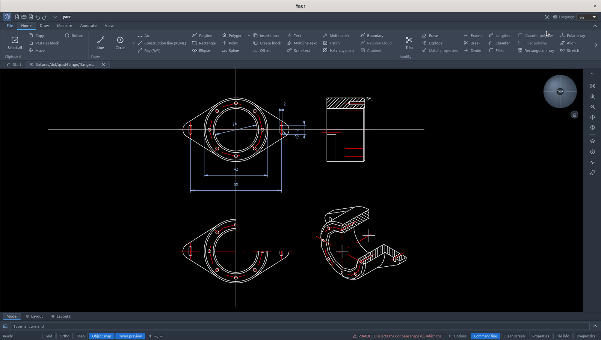
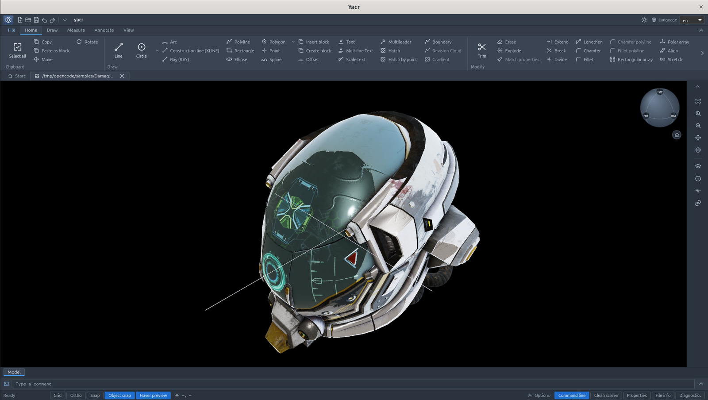
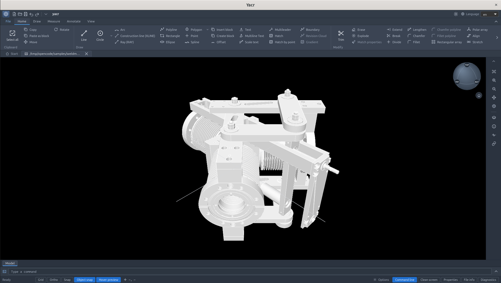
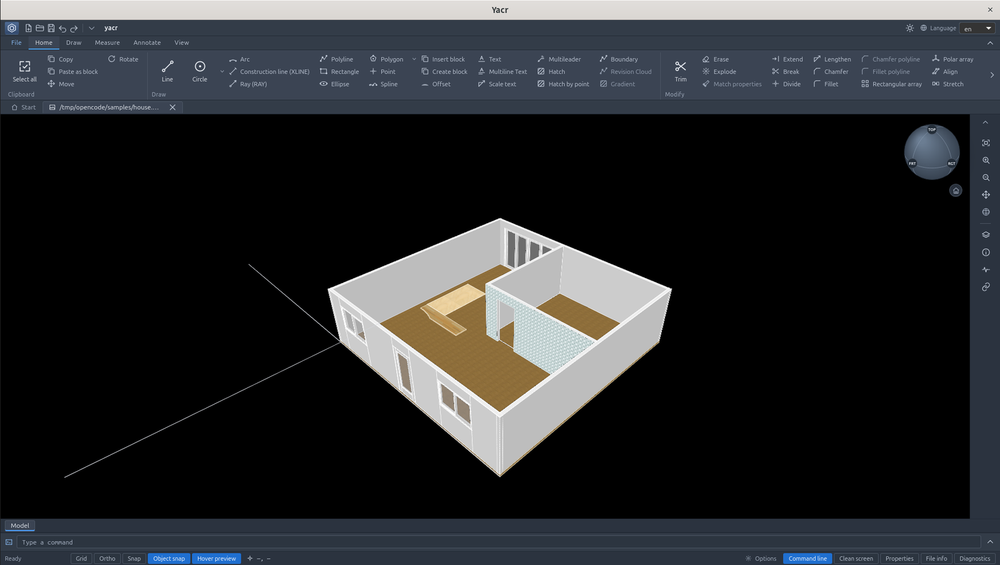
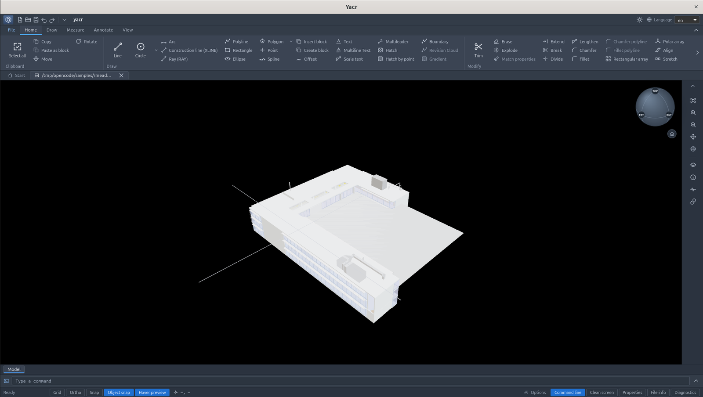

# yacr

[English](README.md) | [中文](README.zh-CN.md)

**用 Rust 写的另一个 CAD。** 开源跨平台 CAD：Rust 核心负责图纸、几何、命令与 wgpu
渲染，一套 React 界面跑在 Linux、Windows、macOS、Android 和浏览器上。

> **PREVIEW** — 预览版今天就能下载运行，但还不是生产级 CAD。能力范围与证据边界记录在
> [`docs/compatibility.md`](docs/compatibility.md)。

**官网** <https://yacr.pages.dev/> · **在线试用** <https://yacr-examples.pages.dev/> ·
**下载** <https://github.com/zenglanmu/yacr/releases>



*Linux 原生 Wayland 上的真实运行截图（NVIDIA Quadro P620，Vulkan/wgpu），打开
`fixtures/dxf/qcad-flange/flange.dxf`。*

## 它能做什么

- **打开你手上已有的图纸。** DWG、DXF（ASCII 与二进制）、Bentley DGN V7/V8 作为 CAD 数据
  打开——图层、直线、圆弧、椭圆、样条、文字、共享单元——单一导入器，带进度与取消。
- **其余格式也能进来看。** OBJ、STL、PLY、OFF、STEP（AP203/214/242）、glTF/GLB、IFC
  （2X3/4/4X3）作为可显示可拾取的网格导入；Revit 工程（`.rvt`/`.rte`）给包围盒预览，
  SketchUp 模型（`.skp`）给三角面预览。
- **2D 绘制与编辑。** LINE、POLYLINE、CIRCLE、ARC、ELLIPSE、SPLINE、POINT、RECTANGLE、
  POLYGON，文字、引线、表格、填充；移动、复制、旋转、缩放、镜像、修剪、延伸、打断、偏移、
  圆角、倒角、阵列、块参照，以及图层与属性写入——每一次编辑都走数据库事务，带撤销。
- **把图纸看清楚。** 实体选择与高亮、图层显示/隐藏/搜索、属性、模型空间与布局切换、
  光栅图像、渐变填充、TEXT/MTEXT 的真实字体整形。
- **量你看到的。** 距离、多段线长度、角度、多边形面积，每个结果都带着它来自的单位、精度与
  几何来源。
- **3D 观察。** 环绕、标准视图、正交或透视，跑在 wgpu 渲染器上，带块级视锥剔除与硬性场景
  预算。
- **出图与导出。** 界面里光栅出图到 PNG；headless CLI 还能出 SVG 与 PDF。可导出 DXF、
  DWG、STL、OBJ、PLY、OFF、IFC4、SKP、glTF。
- **中文或英文。** 一份 i18n 目录驱动整个界面。
- **大图也撑得住。** `fixtures/complex-test.dwg`（约 72.5 万展开图元）能打开并显示；超出
  场景预算时显式失败，而不是把内存吃爆。

厂商自定义对象不会被悄悄丢掉：天正一类的自定义实体按公开的代理图形缓存记录显示。

**命令覆盖。** 981 个 AutoCAD 命令名里有 979 个有实现路径——185 个完整、794 个部分——不
支持的选项按名字拒绝，而不是悄悄干成别的事情。

## 截图

| | |
|---|---|
| <br/>**glTF / PBR** — DamagedHelmet，真实贴图与材质通道 | <br/>**STEP** — 装配体按实体 3D 导入 |
| <br/>**SketchUp** — 房间、门窗与带贴图地面，三角面预览 | <br/>**Revit** — 直接开的 `.rvt` 样本建筑预览 |

## 两个决定产品形态的选择

### 一个 Rust 核心，一套 React 界面，五种载体

核心（`cad-*` crate）拥有文档、几何与命令。`cad-db` 是唯一权威，场景、显示表示与每个像素
都由它派生，所以桌面界面和 headless CLI 共用同一条命令路径。事务产生的 `ChangeSet` 只让
被触碰的部分失效，一次编辑不会重解析整张图。

界面是所有载体共用的一个 React + TypeScript 包，变化的只是文档持有者：原生 Wayland、
Windows、macOS、Android 上由 native 会话持有 `cad-db`，WebView 是覆盖在原生 CAD 表面上的
透明层；X11/XWayland 与 Web 上由 wasm 会话持有，CAD 画在 DOM `<canvas>` 里。没有第二套界面，
也没有第二份文档状态——更没有静默回退：某个载体不具备的能力，按名字显式拒绝。

### `.ymodel` — 自己的文档格式

`.ymodel` 是 yacr 的原生存档格式：zip 容器，每个建模条目是一帧 zstd 承载的分片 JSON，外来
条目按字节原样保留，别的工具写进去的数据不会被重新压缩，也不会丢。

- **保存是增量的。** 提交没碰过的条目，从文档自己上一份归档按压缩字节 raw-copy；只有被改动
  的分片重新编码。保存以原子替换落盘。
- **文档可以自包含。** 字体、外部参照与图片可以内嵌，BIM 定义与关系随文件一起走。
- **有版本、有校验。** manifest 记录格式版本与每条目的摘要，解压前先校验；更新的归档按稳定
  原因拒绝，而不是读一半。

## 平台

| 平台 | 怎么拿到 | 说明 |
|---|---|---|
| **Linux**（`yacr`） | [Flatpak](https://github.com/zenglanmu/yacr/releases) 或[从源码构建](docs/build.md) | 主开发目标。原生 Wayland 走生产路径；X11/XWayland 切换到 DOM-canvas 载体。 |
| **Windows**（`yacr-windows`） | [zip](https://github.com/zenglanmu/yacr/releases) | 真实 Tauri/WebView2 宿主，加一个 Win32 CAD 子窗口。 |
| **macOS**（`yacr-macos`） | [tar.gz](https://github.com/zenglanmu/yacr/releases) | Tauri/WKWebView 加原生 `NSView` CAD 表面。ad-hoc 签名，未公证。 |
| **Android** | [APK](https://github.com/zenglanmu/yacr/releases) | 同一套 React 界面，原生 `CadSession` 与 Vulkan 表面。 |
| **Web** | [yacr-examples.pages.dev](https://yacr-examples.pages.dev/) | wasm 会话，CAD 画在 DOM canvas 上。在页面上打开图纸；浏览器包只编了 DWG/DXF 连接器，写出只有 `.dxf`、PNG、SVG 或 PDF。 |

每个产物都是预览版。打包成功不等于运行或 GPU 验收；各载体状态见
[`docs/compatibility.md`](docs/compatibility.md) 与 [`docs/`](docs/) 下的宿主文档。

## 上手

**下载**：到 [Releases 页面](https://github.com/zenglanmu/yacr/releases)取对应平台的构建，
或者直接[打开网页版](https://yacr-examples.pages.dev/)。

**从源码跑（Linux，主目标）：**

```bash
bash scripts/run-react-linux.sh --open /absolute/drawing.dwg
```

工具链、系统依赖和其它载体见 [`docs/build.md`](docs/build.md)；Linux 宿主参数与后端策略见
[`docs/react-linux-app.md`](docs/react-linux-app.md)。

**Headless 出图：**

```bash
cargo build -p cad-cli-tools --release --locked
./target/release/cad-cli-tools render /absolute/drawing.dwg --png out.png
```

## 已知限制

- 不是生产级，DWG 兼容性没有针对语料验证过；各类实体保真度不一。
- `.ymodel` 是原生格式。DWG 来源的图纸回写 DWG 仍是实验性的；其它导入来源存为 DXF。
- 没有 3D 实体建模（显式拒绝）；ACIS 实体只按子集做剖分显示。
- Revit 是包围盒预览，SketchUp 是三角面预览——这两者没有边、贴图或测量。
- 没有代理图形缓存的厂商实体无可显示内容。
- 3D 观察与出图属于显示能力，没有 CTB/HPGL 打印路径。

逐项状态见 [`docs/compatibility.md`](docs/compatibility.md) 与
[`docs/dxf-entity-coverage.md`](docs/dxf-entity-coverage.md)。

## 开发者

需求规格：[`CAD_IMPLEMENTATION_SPEC.md`](CAD_IMPLEMENTATION_SPEC.md) · crate 边界与不变量：
[`docs/architecture.md`](docs/architecture.md)、[`docs/core-invariants.md`](docs/core-invariants.md) ·
构建与门禁：[`docs/build.md`](docs/build.md) · CLI：[`docs/cli.md`](docs/cli.md) · 界面决策：
[`docs/adr/`](docs/adr/)。

yacr 是独立实现。DWG/DXF 读写使用 [acadrust](https://github.com/hakanaktt/acadrust)
（未修改的 0.6.8），开源 QCAD `flange` 样本用作 fixture。更多参考与第三方许可见
[`THIRD_PARTY_NOTICES.md`](THIRD_PARTY_NOTICES.md) 与 [`fonts/SOURCE.md`](fonts/SOURCE.md)。

## 许可

AGPL-3.0，见 [`LICENSE`](LICENSE)。联系：zenglanmu@126.com
